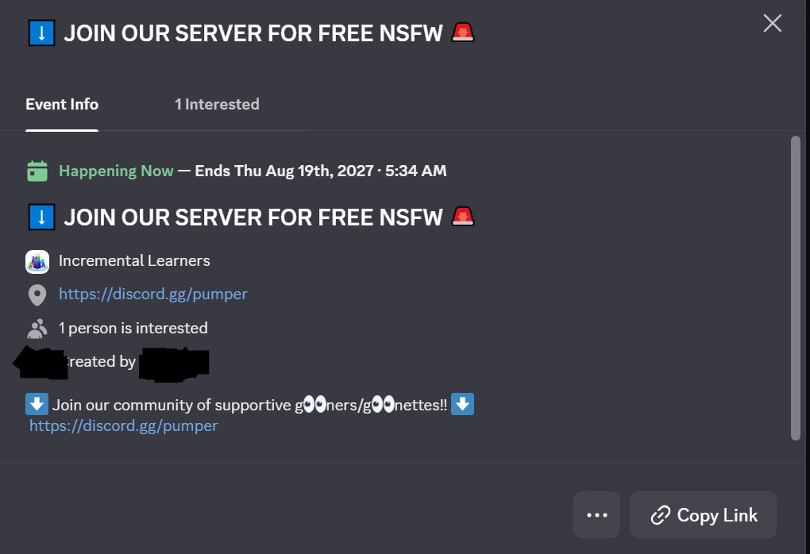

# Discord Compromise Cleanup

You (or someone you know) got their discord account hacked. The bot sent spam, made phishing events, blocked
your friends, hid their messages. This will reverse what the bot did.

Works on windows/Linux/Mac. 

## ⚠ Terms of service warning

Using a user token to automate Discord actions violates [Discord's
ToS](https://discord.com/terms) (section 3). Your account can be banned.
The script paces slow (2.5 s/call) to minimize detection but can't
eliminate it. unlikely here but worth mentioning.

## Pre-flight

Do these before running. If you skip them, the attacker's session is
still live and anything you clean up gets re-spammed.

1. **Change your password** (User Settings → My Account).
2. **Enable 2FA** (same page). Save backup codes offline.
3. **Revoke Authorized Apps** (User Settings → Authorized Apps) —
   these keep working after a password change.
4. **Log out all devices** (User Settings → Devices → "Log Out All
   Known Devices"). The script can't do this for you.

## Get your Discord token

**Use the Discord web app at [discord.com/app](https://discord.com/app).**
The desktop client disables DevTools.

**Option A — Chrome extension (easiest):** Install [Discord Token
Checker](https://chromewebstore.google.com/detail/discord-token-checker/lgdoombkkahcmffklnieoakenhakmjmk),
log into Discord in Chrome, click the extension icon, copy the token.
Uninstall the extension when done.

**Option B — DevTools (no install):**
1. Log into `discord.com/app` with your new password.
2. `Ctrl+Shift+I` → **Network** tab → filter `/api`.
3. Click any channel. Click any `/api/v9/…` request in Network.
4. Request Headers → copy the `Authorization:` value.

Ignore Discord's red "STOP!" warning — that's for scam victims, you're
copying your own token.

**Never paste your token into a chat, screenshot, or anywhere you don't
control.**

## How to run

**Easiest — download the prebuilt binary** from the
[latest release](https://github.com/RecursiveFunctions/discord-compromise-cleanup/releases/latest):

- **Windows** → `discord-compromise-cleanup-windows.exe` → double-click
- **macOS** → `discord-compromise-cleanup-macos` → right-click → Open
  the first time (bypasses Gatekeeper)
- **Linux** → `discord-compromise-cleanup-linux` → `chmod +x` then
  double-click or run from terminal

No Python install needed. Downloads are ~10 MB (self-contained).

<details>
<summary><b>Run from source</b> (requires Python 3.9+, use this if the
binary doesn't work for your OS or you want to read / modify the code)</summary>

**Step 1 — get the code.** Either clone the repo (needs Git):

```bash
git clone https://github.com/RecursiveFunctions/discord-compromise-cleanup.git
cd discord-compromise-cleanup
```

Or, if you don't have Git, [download the ZIP](https://github.com/RecursiveFunctions/discord-compromise-cleanup/archive/refs/heads/master.zip)
and unzip it. All you actually need from the repo is the single file
`discord-compromise-cleanup.py` — you can also just save that file
directly from
[its raw view](https://raw.githubusercontent.com/RecursiveFunctions/discord-compromise-cleanup/master/discord-compromise-cleanup.py)
(right-click → Save As).

**Step 2 — make sure Python 3.9+ is installed.**

- **Windows / macOS:** [python.org/downloads](https://www.python.org/downloads/).
  On Windows, check **"Add python.exe to PATH"** during install.
- **Linux:** `sudo apt install python3 python3-tk`
  (or your distro's equivalent).

**Step 3 — launch.**

- Double-click `discord-compromise-cleanup.py` (Windows / macOS /
  Linux file managers all support this).
- Or from a terminal: `python3 discord-compromise-cleanup.py`.

**CLI mode (scripters):**

```bash
python3 discord-compromise-cleanup.py --cli --token-file ~/.discord-token --go
```

Pass `--help` for all flags.
</details>

## What a compromise looks like

### Scheduled events



Pattern: your account creates an event with a lure name (`FREE NSFW`,
`FREE NITRO`, airdrop) linking to a `discord.gg/` invite the attacker
controls. Server members get notified, think it's from you, (and now they think you're a gooner)

### DM spam

Pattern: a short message with 4 image attachments and content that's
either empty or just a bare `<@mention>` of the recipient. The
attachments are the lure (fake Nitro gift, fake crypto airdrop, QR
code to a phishing site). The bot DMs every friend plus people in
your contacts list

Variants also seen in the wild: text messages with `discord.gift/`,
`dsc.gg/`, nitro gift URLs, `free robux`, `@everyone`, `@here`.

### Relationship-state abuse

- Blocks your friends so you can't see them
- Toggles the "Ignore messages" state on your friends and DMs
- Sends outgoing friend requests to accomplice accounts
- Removes you from group chats (not undoable)

## What the GUI does


1. Paste token (masked) or load from file.
2. Set the compromise window in UTC. Default = last 24 h.
3. Pick phases: DMs, group DMs, group departures (report-only), server
   events, server messages, relationships.
4. **Scan (dry run)** — lists what would be deleted, deletes nothing.
5. **Delete (execute)** — confirms, then runs. Writes
   `discord-cleanup-audit.json` next to the script.
6. **Stop** — enabled while a scan or delete is running. Click any time
   to cancel: the engine finishes the current API call (max 1-2 s),
   writes a partial audit log if it was deleting, and the GUI returns
   to idle. Safe to use mid-run; nothing is left in a half-done state.

## What it looks for

**Messages — delete if either:**
- 1+ attachment AND content is empty or just `<@id>`, OR
- content matches `discord.gift/ | dsc.gg/ | discordapp.gift/ | nitro.gift
  | free (nitro|robux) | gifted nitro | steamcommunity.com/ | airdrop
  | @everyone | @here`

Normal `discord.gg/` server invites are **not** flagged (people share
legit invites). If the attacker shared a server invite, delete manually.

**Events — delete if all:**
- `creator_id == you`, AND
- location is a `discord.gg/` / `dsc.gg/` / `discord.gift/` URL, OR
  name/description matches the lure regex (`FREE NSFW/NITRO/ROBUX`,
  nitro giveaway, airdrop).

Your real events (D&D night, movie watch) stay.

**Relationships:**
- All blocks removed
- All outgoing friend requests cancelled
- All friend-ignores cleared
- `DELETE /users/@me/relationships/{uid}/ignore` on every DM recipient
  (covers non-friend DM-level ignore, which no REST endpoint surfaces)

## What it does NOT do

- **Log out other sessions.** That endpoint needs your password.
- **Undo group DM leaves.** No API for it; a member has to re-add you.
- **Touch servers you got kicked from.** Can't see them anymore.
- **Delete `discord.gg/` server invites.** Too many false positives.
- **Delete your own apology messages.** Those are yours to keep.

## Risk mitigations the script uses

- Dry-run default (click Scan before Delete)
- 2.5 s/call default pacing (adjustable)
- Honors Discord's `Retry-After` on 429s
- Aborts on 401 so a token-kill doesn't loop into a ban
- JSON audit log of every deletion

## License

MIT. Use at your own risk; see the ToS warning.
